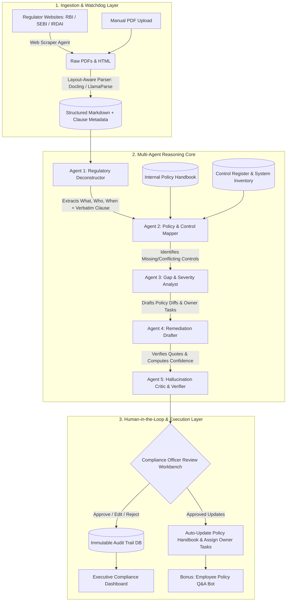

# 🛡️ AI Regulatory Change & Compliance Copilot
> **Autonomous Multi-Agent RegTech System for Indian Financial & Data Privacy Compliance (RBI, SEBI, IRDAI, & DPDP Act 2023)**

[](#)
[](#)
[](#)
[](#)

---

## 📖 1. Problem Statement

Regulated companies operating in India receive a relentless stream of new circulars, master directions, amendments, and data-protection rules from regulatory bodies such as the **Reserve Bank of India (RBI)**, **Securities and Exchange Board of India (SEBI)**, and **Insurance Regulatory and Development Authority of India (IRDAI)**, alongside stringent statutory obligations under India’s **Digital Personal Data Protection (DPDP) Act, 2023**.

Currently, compliance, legal, and risk teams handle this workflow manually:
1. **Manual Ingestion:** Reading dense, multi-page PDFs and tracking cross-referenced annexures.
2. **Siloed Impact Analysis:** Figuring out via spreadsheets which internal policies, processes, IT systems, and controls are impacted.
3. **Fragmented Execution:** Chasing engineering, product, and operations owners over email and Slack for remediation.

**The Consequence:** Missed deadlines, misinterpreting complex clauses, or delayed implementations lead to **heavy monetary penalties, adverse regulatory audit findings, operational embargoes, and severe reputational damage.**

---

## 🎯 2. The Challenge

Build an **Agentic AI System** that autonomously monitors regulatory updates, extracts actionable obligations, maps them against the organization’s internal policies, controls, and IT systems, identifies compliance gaps, and drafts an executable action plan for control owners.

### Core Governance Guardrails
* **Deterministic Citations:** Every finding must cite the **exact regulatory clause, page, and section** behind it (zero unsupported claims).
* **Calibrated Confidence Scores:** The system must expose confidence metrics for both extraction accuracy and policy-mapping relevance.
* **Human-in-the-Loop (HITL) Sign-Off:** AI does not make final legal decisions. Every interpretation, gap severity rating, and policy redline is routed to a **Compliance Officer** for review, modification, or rejection, backed by an immutable **Audit Trail**.

---

## ✨ 3. Expected Capabilities & Feature Matrix

| Capability | Description | Target User |
| :--- | :--- | :--- |
| **1. Multi-Source Ingestion** | Parse complex regulatory PDFs (tables, annexures, footnotes) and scrape live regulator websites (RBI, SEBI, IRDAI, MeitY). | System / Automated |
| **2. Atomic Obligation Extraction** | Deconstruct legalese into structured obligations: **What** must be done, by **Whom** (applicability/role), and by **When** (effective date/SLA). | Legal & Compliance |
| **3. Cross-Walk & Mapping** | Semantically map extracted obligations to internal **Policy Handbooks**, **Control Registers**, and **IT System Inventories**. | Risk & GRC Teams |
| **4. Automated Gap Analysis** | Identify **Missing**, **Partial**, or **Conflicting** controls, automatically assigning **Severity Levels** (Critical/High/Medium/Low) and tracking deadlines. | Compliance Officers |
| **5. Auto-Drafted Remediation** | Generate **Git-style policy redlines** (before/after diffs) and actionable task tickets (e.g., Jira/ServiceNow payloads) assigned to specific control owners. | Control & System Owners |
| **6. Clause-Level Citations & Summaries** | Provide plain-English executive summaries alongside verbatim source quotes linked directly to the PDF bounding box/section. | Executive Leadership |
| **7. Live Compliance Dashboard** | Real-time visibility into open circulars, pending reviews, overdue obligations, and overall organizational compliance posture. | CISO / CCO / Auditors |
| **8. Officer-in-the-Loop & Audit Log** | Dedicated review workbench to **Approve, Edit, or Reject** AI findings with mandatory rationale logging and version history. | Compliance Officer |

---

## 🚀 4. Scope of Work

### ✅ Minimum Viable Scope (Must Work in the Demo)
1. **Ingestion & Extraction:** Ingest **3–5 regulatory circulars** (PDFs) and extract structured obligations, each with its exact source clause cited and a plain-language summary.
2. **Mapping & Gap Detection:** Map the extracted obligations against a **mock internal policy handbook** and **control register**, flagging specific compliance gaps along with calculated severity and deadlines.
3. **Action & Policy Drafting:** Automatically draft concrete action items (for system/control owners) and exact policy wording updates (redlines) for the responsible owners.
4. **Compliance Officer Review Workbench:** Interactive UI screen allowing a compliance officer to **Approve, Edit, or Reject** each finding, capturing a timestamped, immutable **audit trail**.

### 🌟 Bonus Capabilities (High-Impact Differentiators)
* **💬 Policy-Grounded Employee Q&A Assistant:** An internal Slack/web copilot (e.g., *"Can we store customer Aadhaar or PAN in this third-party analytics tool?"*) that answers strictly grounded in **approved internal policies** and active regulatory baselines.
* **🔍 DPDP Personal-Data Discovery Agent:** An automated scanner that connects to sample database schemas/CSV dumps, detects unencrypted or unconsented **PII / DPDP-sensitive fields** (e.g., Aadhaar, biometric tags, financial identifiers, children's data), and flags violations against the DPDP Act 2023.
* **🌐 Autonomous Regulator Watchdog:** Scheduled background scraper that monitors RBI/SEBI/IRDAI RSS feeds and notification pages for new circulars, triggering the ingestion pipeline automatically upon detection.

---

## 🧠 5. Agentic System Architecture

To achieve high precision and zero hallucination, the system uses a **Supervisor-driven Multi-Agent Workflow** (built via LangGraph / CrewAI):



### Breakdown of Specialized Agents
1. **🕷️ Watchdog & Layout Parser Agent:** Converts complex multi-column regulatory PDFs and tabular annexures into hierarchical JSON/Markdown while preserving page numbers and section IDs (`Section 4.2(a)`).
2. **⚖️ Obligation Extraction Agent:** Uses structured LLM outputs (Pydantic) to isolate mandatory obligations (`"shall"`, `"must"`, `"is required to"`) from background commentary.
3. **🧭 Cross-Walk & Mapping Agent:** Performs Hybrid Search (Dense Vector + BM25 Keyword + Reranking) against the internal Policy Handbook and Control Register to find corresponding internal rules.
4. **🚨 Gap Analysis & Risk Scoring Agent:** Compares the regulatory requirement against the internal control. Classifies states as `COMPLIANT`, `PARTIAL_GAP`, or `CRITICAL_GAP` and calculates confidence scores based on semantic entailment and citation overlap.
5. **✍️ Policy Redliner & Task Agent:** Generates exact markdown diffs (`- old policy clause` / `+ new compliant clause`) and assigns remediation tasks to the mapped `Control_Owner` (e.g., *Head of InfoSec*, *DPO*, *Cloud Architect*).
6. **🛡️ Critic & Verification Agent:** Validates that every cited clause actually exists verbatim in the source PDF before presenting the output to the human reviewer.

---

## 🗂️ 6. Core Data Schemas (JSON Contract)

### A. Extracted Obligation & Gap Mapping Object
```json
{
  "obligation_id": "OBL-RBI-2024-089-01",
  "source_document": {
    "regulator": "RBI",
    "circular_number": "RBI/2023-24/107 DoS.CO.CSITEG/SEC.7/31.01.015/2023-24",
    "title": "Master Direction on Information Technology Governance, Risk, Controls and Assurance Practices",
    "clause_citation": "Chapter IV, Section 14(b), Page 18",
    "verbatim_quote": "Regulated Entities (REs) shall ensure that all critical IT systems undergo Vulnerability Assessment (VA) at least once every six months and Penetration Testing (PT) at least once in twelve months."
  },
  "extracted_obligation": {
    "plain_language_summary": "All critical IT systems must undergo Vulnerability Assessments (VA) every 6 months and Penetration Testing (PT) every 12 months.",
    "action_required": "Conduct bi-annual VA and annual PT on critical IT assets.",
    "applicable_to": "Information Security Team / CISO",
    "effective_deadline": "2024-04-01",
    "obligation_type": "Mandatory Control"
  },
  "internal_mapping": {
    "matched_policy_id": "POL-INFOSEC-04 (Section 3.2: Security Testing)",
    "matched_control_id": "CTRL-SEC-019",
    "affected_systems": ["Core Banking API", "Customer KYC Portal"],
    "current_internal_state": "Internal policy currently mandates both VA and PT only once every 12 months."
  },
  "gap_analysis": {
    "status": "PARTIAL_GAP",
    "severity": "HIGH",
    "gap_description": "Vulnerability Assessment (VA) frequency in internal policy (12 months) is slower than RBI's mandate (6 months).",
    "confidence_score": 0.96,
    "confidence_rationale": "Exact match on control domain (VA/PT); clear numeric discrepancy (12 months vs 6 months)."
  },
  "proposed_remediation": {
    "policy_diff": {
      "before": "Section 3.2: Critical systems shall undergo VA and PT annually (every 12 months).",
      "after": "Section 3.2: Critical systems shall undergo Vulnerability Assessment (VA) bi-annually (every 6 months) and Penetration Testing (PT) annually (every 12 months), per RBI IT Governance Master Direction Sec 14(b)."
    },
    "owner_action_item": {
      "assigned_to": "ananya.sharma@company.com (VP, InfoSec)",
      "task_title": "Update VA Schedule to 6-Month Cadence for Core Banking & KYC Systems",
      "due_date": "2024-03-25"
    }
  },
  "review_state": {
    "status": "PENDING_REVIEW",
    "reviewed_by": null,
    "reviewed_at": null
  }
}
```

### B. Immutable Audit Trail Object
```json
{
  "audit_id": "AUD-99281-X",
  "obligation_id": "OBL-RBI-2024-089-01",
  "timestamp": "2025-02-20T14:32:10Z",
  "actor_id": "rajesh.iyer@company.com",
  "actor_role": "Chief Compliance Officer",
  "action": "APPROVED_WITH_EDITS",
  "previous_value": { "severity": "MEDIUM", "due_date": "2024-04-01" },
  "updated_value": { "severity": "HIGH", "due_date": "2024-03-25" },
  "officer_comments": "Escalated severity to HIGH as Core Banking audit is scheduled next quarter."
}
```

---

## 📦 7. Suggested Dataset & Mock Assets for the Demo

To make the demo immediately impactful, use these **5 real public Indian regulatory documents** alongside an intentionally flawed **Mock Internal Policy & Control Register** so the AI surfaces realistic gaps:

### 1. Public Circulars to Ingest (5 PDFs)
1. **DPDP Act, 2023 (MeitY):** *Section 6 (Consent & Withdrawal)* and *Section 8 (General Obligations of Data Fiduciary, Data Breach Notification, Data Retention Erasure).*
2. **RBI Digital Lending Guidelines (RBI/2022-23/111):** *Cooling-off/look-up period, explicit borrower consent before sharing data with third parties, and localized storage of all lending data in servers within India.*
3. **RBI Master Direction on IT Governance, Risk, Controls and Assurance Practices (2023):** *VA/PT cadence, Disaster Recovery (DR) drills every 6 months, and CISO reporting lines.*
4. **SEBI Framework for Adoption of Cloud Services by SEBI Regulated Entities (2023):** *Data localization, cryptographic key management (BYOK), and mandatory right-to-audit clauses in Cloud Service Provider (CSP) contracts.*
5. **IRDAI Information and Cyber Security Guidelines (2023):** *6-hour incident reporting window to CERT-In/IRDAI and 180-day log retention.*

### 2. Built-in Demo Scenarios (Intentional Gaps in Mock Data)
Design your `mock_policy_handbook.md` and `control_register.csv` with these specific flaws so your demo highlights them effortlessly:

| Scenario | Regulator Rule (Source PDF) | Mock Internal Policy / Control | Expected AI Gap Output |
| :--- | :--- | :--- | :--- |
| **Scenario 1: Incident Reporting SLA** | **IRDAI / CERT-In:** Report cyber incidents within **6 hours** of detection. | `POL-SEC-02`: Report critical incidents within **72 hours**. | 🔴 **CRITICAL GAP** (SLA mismatch: 72h vs 6h). Auto-redlines policy to 6 hours. |
| **Scenario 2: Data Localization** | **RBI Digital Lending Clause 11:** All data must be stored exclusively on servers located **within India**. | `CTRL-CLOUD-04`: AWS backup buckets configured in `ap-southeast-1` (Singapore). | 🔴 **CRITICAL GAP** (Cross-border storage violation). Assigns DevOps task to migrate to `ap-south-1` (Mumbai). |
| **Scenario 3: Consent Withdrawal** | **DPDP Act Sec 6(4):** Ease of withdrawing consent must be comparable to ease of giving consent. | `POL-PRIV-01`: Users must email support and wait 14 days to revoke marketing/data consent. | 🟠 **HIGH GAP** (Friction in consent withdrawal). Creates Product task to add 1-click consent toggle in UI. |
| **Scenario 4: VA/PT Frequency** | **RBI IT Master Direction:** VA every **6 months**, PT every **12 months**. | `CTRL-SEC-09`: Annual VA and PT (every 12 months). | 🟠 **HIGH GAP** (VA cadence insufficient). Updates Control Register schedule. |

---

## 🛠️ 8. Recommended Tech Stack

| Layer | Recommended Tools | Why? |
| :--- | :--- | :--- |
| **Document Parsing** | `Docling` / `LlamaParse` / `PyMuPDF4LLM` | Preserves complex table structures, clause numbering, and page coordinates in RBI/SEBI PDFs. |
| **Agent Orchestration** | `LangGraph` or `CrewAI` | Enables cyclic state machines, human-in-the-loop (`interrupt_before`) breakpoints, and deterministic routing. |
| **LLM Backbone** | `GPT-4o` / `Claude 3.5 Sonnet` / `Gemini 1.5 Pro` | Best-in-class structured output adherence, long-context legal reasoning, and low citation hallucination. |
| **Vector & Hybrid Search** | `Qdrant` or `ChromaDB` + `BM25` | Hybrid retrieval ensures exact regulatory terms (e.g., `"CERT-In"`, `"Section 8(6)"`) and semantic concepts both match. |
| **Backend & Audit DB** | `FastAPI` + `PostgreSQL` / `SQLite` | Stores structured obligations, relational mappings to controls, and append-only audit logs. |
| **Frontend Workbench** | `Next.js (React + Tailwind + Shadcn UI)` or `Streamlit` | Split-screen PDF viewer with highlighted citations on the left, and redline approval cards on the right. |

---

## 🎬 9. Step-by-Step Winning Demo Flow (5 Minutes)

1. **Minute 1 — The Compliance Dashboard & Live Ingestion (MVP #1):**
   * Show the executive dashboard with current compliance health.
   * Upload a fresh RBI/DPDP circular PDF (or trigger the **Bonus Website Watchdog**). Watch the agents parse the PDF and extract atomic obligations (What, Who, When) with **exact clause citations** and **confidence scores** (`96%`).
2. **Minute 2 — Automated Cross-Walk & Gap Matrix (MVP #2):**
   * Click into an extracted obligation. Show how the system mapped it to `mock_policy_handbook.md` and `control_register.csv`.
   * Highlight a **Critical Gap** (e.g., *Singapore AWS bucket vs. RBI India Data Localization mandate*, or *72-hour vs. 6-hour breach reporting*).
3. **Minute 3 — Auto-Drafted Redlines & Owner Tasks (MVP #3):**
   * Open the **Remediation Tab**. Show the side-by-side **Policy Redline Diff** (old wording crossed out in red, new RBI-compliant wording in green) and the auto-generated Jira/Email task ready for the Control Owner.
4. **Minute 4 — Compliance Officer-in-the-Loop & Audit Trail (MVP #4):**
   * Switch to the **Compliance Officer Review Screen**.
   * **Approve** one finding, **Edit** the deadline/wording of a second finding, and **Reject** a low-confidence finding with a comment.
   * Open the **Audit Trail Log** to prove every human override, timestamp, and rationale was cryptographically/immutably recorded.
5. **Minute 5 — Bonus Capabilities Showcase:**
   * **Employee Q&A Bot:** Type *"Can our marketing team export customer phone numbers to a US-based SaaS tool?"* Show the bot refusing and citing the newly approved internal policy + RBI/DPDP clause.
   * **DPDP Data Discovery Scanner:** Run a 1-click scan on a sample `customers_dump.sql` table and watch the agent flag unmasked `aadhaar_number` and `dob` columns as high-risk DPDP Personal Data.

---

## 📊 10. Evaluation Metrics & Guardrails

* **Citation Fidelity Rate (Target: 100%):** Percentage of extracted obligations where the `verbatim_quote` is a character-for-character substring of the source PDF.
* **Confidence Calibration:** Calculated using a weighted formula:
  $$\text{Confidence} = 0.40 \times (\text{Quote Verification}) + 0.35 \times (\text{Vector Cosine Similarity}) + 0.25 \times (\text{Critic Entailment Score})$$
* **Zero-Autonomous-Publish Rule:** No policy handbook update or external ticket is committed until `review_state.status == "APPROVED"`.